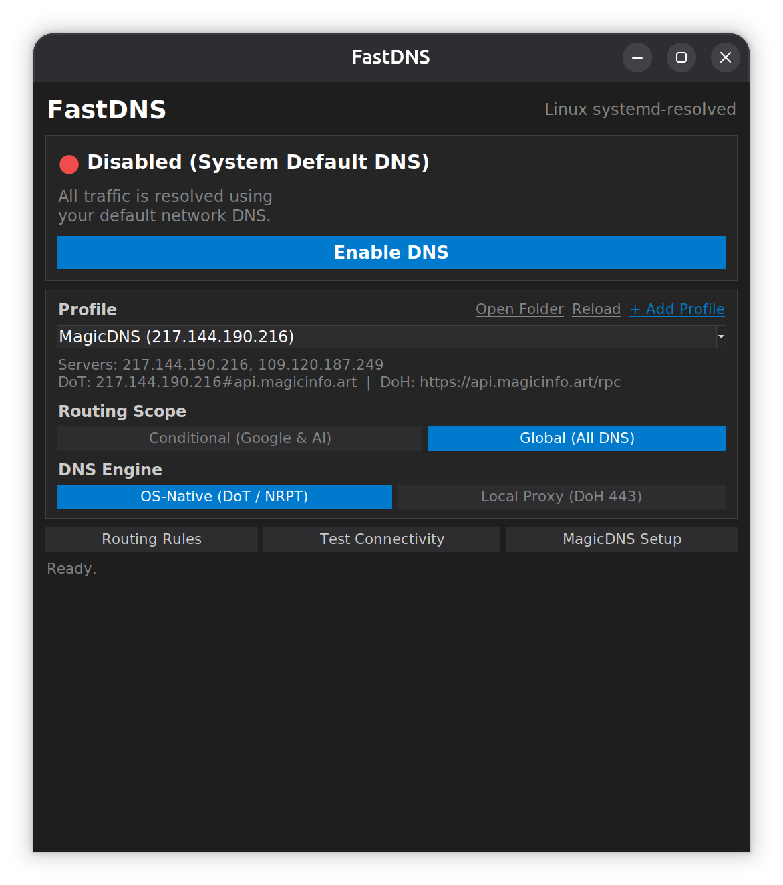
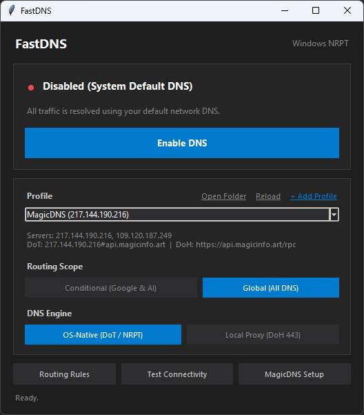

# FastDNS

<p align="center">
  
  
</p>


Cross-platform DNS switcher for Linux (Ubuntu/Debian/Mint) and Windows 10/11.
Routes DNS traffic globally or conditionally (Google, Gemini, Antigravity) using custom DNS profiles in `dns_profiles/`.

## Requirements

- Python 3.8 or newer (uses only the Python standard library)
- Tkinter for the desktop GUI:
  - Linux (Ubuntu/Debian/Mint): `sudo apt install python3-tk`
  - Windows: included with the standard Python installer from python.org

## Run Without Installing

### Linux

```bash
./run_linux.sh
# or:
python3 main.py
```

### Windows

Double-click `run_windows.bat`, or run in Command Prompt / PowerShell:

```bat
python main.py
```

## Install

### Standalone AppImage (Linux) & EXE (Windows)

FastDNS can be run directly or installed from standalone single-file builds (no Python installation required):

- **Linux (`FastDNS-x86_64.AppImage`)**:
  ```bash
  chmod +x FastDNS-x86_64.AppImage
  ./FastDNS-x86_64.AppImage
  # Or integrate into your app menu and PATH:
  ./install_linux.sh --appimage ./FastDNS-x86_64.AppImage
  ```
- **Windows (`FastDNS.exe`)**:
  Run `FastDNS.exe` directly as a portable app, or install it with Start Menu / Desktop shortcuts and uninstaller support:
  ```powershell
  .\install_windows.ps1 -ExePath .\FastDNS.exe
  ```
  (Both `install_linux.sh` and `install_windows.ps1` also auto-detect a `FastDNS-*.AppImage` or `FastDNS.exe` placed alongside the script or in `dist/`.)

### Linux (From Source)

Install for the current user (`~/.local/share/fastdns`, `~/.local/bin/fastdns`, and application menu entry):

```bash
./install_linux.sh --from-source
```

Or install system-wide (`/opt/fastdns` and `/usr/local/bin/fastdns`):

```bash
sudo ./install_linux.sh --system
```

To uninstall:

```bash
./install_linux.sh --uninstall
# or if installed system-wide:
sudo ./install_linux.sh --system --uninstall
```

### Windows (From Source)

Double-click `install_windows.bat`, or run in PowerShell:

```powershell
.\install_windows.ps1
```

This installs FastDNS to `%LOCALAPPDATA%\Programs\FastDNS`, creates Start Menu and Desktop shortcuts, and registers an uninstaller in Windows Installed Apps. If Python is not installed and no `FastDNS.exe` is present, the script offers to install Python via `winget`.

For a system-wide install (`C:\Program Files\FastDNS`), run PowerShell as Administrator:

```powershell
.\install_windows.ps1 -System
```

To uninstall, use Windows Installed Apps ("FastDNS"), run `uninstall.bat` in the install folder, or run:

```powershell
.\install_windows.ps1 -Uninstall
```

### Building Standalone Packages

- **Linux AppImage** (requires `python3`, `python3-tk`, `pyinstaller`, and `appimagetool`):
  ```bash
  ./build_appimage.sh
  ```
  Outputs `dist/FastDNS-<arch>.AppImage`.

- **Windows Standalone EXE** (on Windows with Python installed):
  ```bat
  build_windows.bat
  ```
  Outputs a single standalone `dist\FastDNS.exe` using PyInstaller, and if Inno Setup 6 is installed, also builds `dist\FastDNS-Setup.exe`.

## CLI Usage

```bash
python3 main.py --list-profiles  # List all profiles in dns_profiles/
python3 main.py --status         # Show current DNS routing status
python3 main.py --test           # Test active profile DoH/DoT endpoints
python3 main.py --enable         # Enable DNS routing
python3 main.py --disable        # Disable DNS routing and restore defaults
python3 main.py --list-domains   # List routed domains for the active profile
python3 main.py --profile <id>   # Select active profile
```

## Custom Profiles (`dns_profiles/`)

Drop any `.json` file into `dns_profiles/` (for example `dns_profiles/my_dns.json`):

```json
{
  "id": "my_dns",
  "name": "My Custom DNS",
  "primary_dns": "1.1.1.1",
  "secondary_dns": "1.0.0.1",
  "dot_hostname": "one.one.one.one",
  "doh_url": "https://cloudflare-dns.com/dns-query",
  "description": "Cloudflare DNS"
}
```
